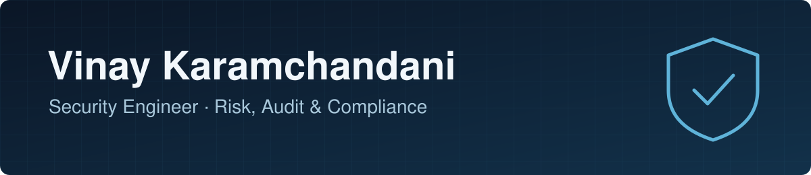

  

  
  
  

  

## About me

I'm a Security Engineer focused on risk, audit, and compliance. I work on strengthening security frameworks and keeping organizations aligned with regulatory requirements, with a foundation in cloud environments and risk management.

- 🎓 MS in Cybersecurity, Drexel University
- 📍 Scottsdale, Arizona
- 💼 Open to full-time IT compliance, risk management, and security engineering roles

<!-- Add only the frameworks you have actually worked with, for example:
- 🛡️ Frameworks: NIST CSF, ISO 27001, SOC 2
Recruiters for GRC roles search for these terms. -->

## Tech stack

**Cloud and infrastructure**

**Languages and data**

## Let's connect

If you're hiring for security, risk, or compliance work, [message me on LinkedIn](https://www.linkedin.com/in/vinaykaramchandani/) or [send me an email](mailto:vinaykaramchandani74@gmail.com).
